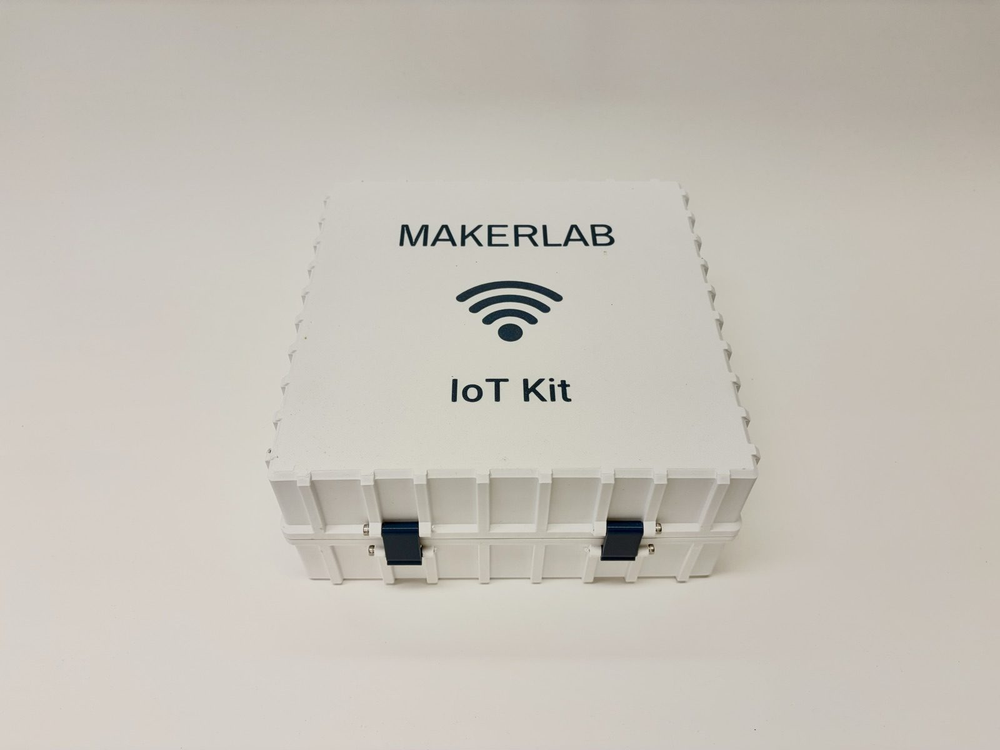
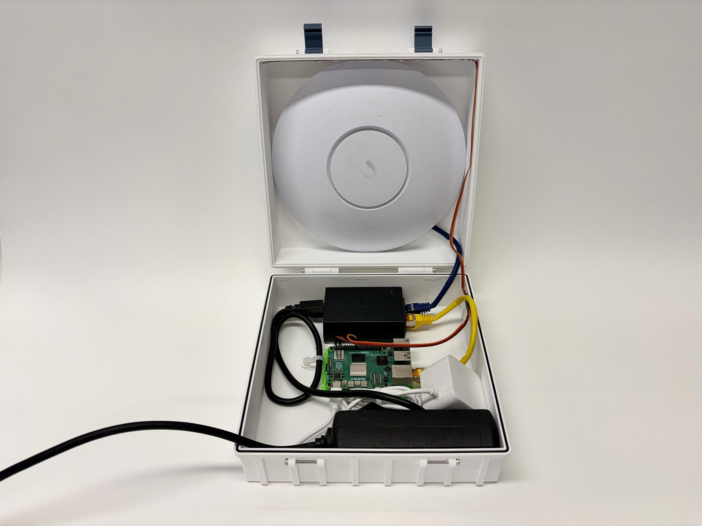
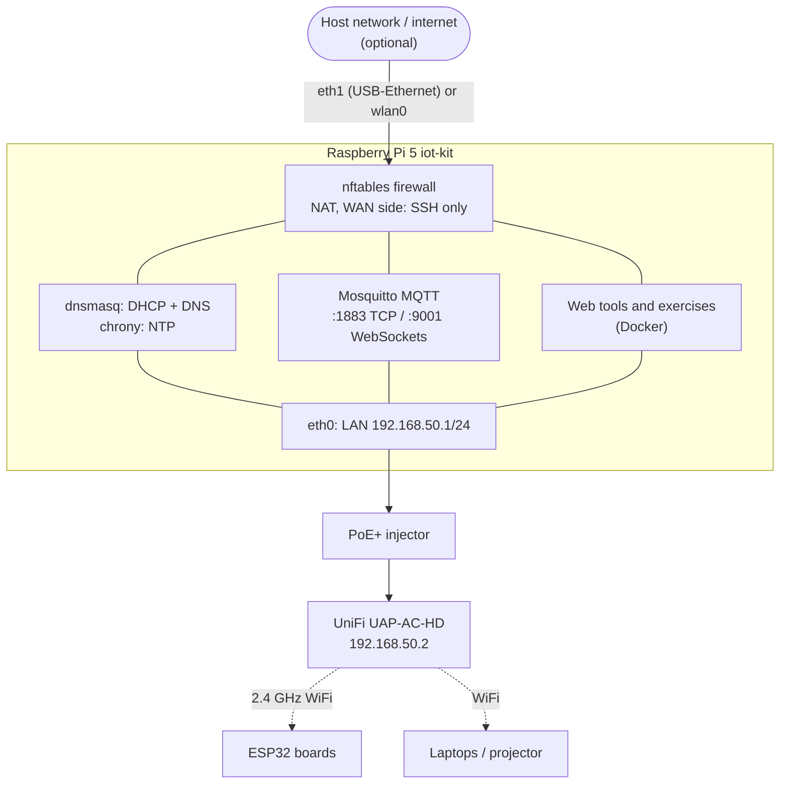
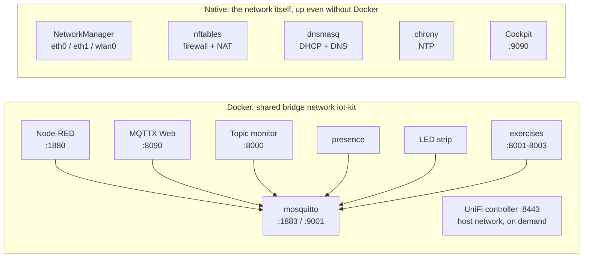
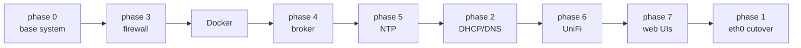
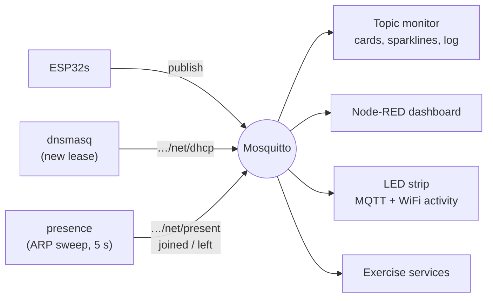

# iot-kit

**A portable, self-contained network box for ESP32 / IoT workshops, built on a Raspberry Pi 5.**

<table>
  <tr>
    <td width="50%"></td>
    <td width="50%"></td>
  </tr>
  <tr>
    <td align="center"><sub>Closed: one power cable in, WiFi out.</sub></td>
    <td align="center"><sub>Open: the UniFi AP in the lid; the Pi 5, PoE+ injector and power supply in the base.</sub></td>
  </tr>
</table>

Plug in the Pi and its access point and you get, in any classroom, your own
WiFi with DHCP, DNS, an MQTT broker, NTP time and a set of projector-ready web
tools: no school network, no internet, no accounts needed. When an internet
uplink is available, the kit NATs through it, and the host network only ever
sees the Pi.

- **Works fully offline.** DHCP, DNS (`broker.lan`), MQTT and NTP keep
  working with no uplink at all.
- **ESP32-friendly WiFi.** 2.4 GHz, WPA2-PSK, no roaming tricks; see the
  [WLAN checklist](docs/access-point.md#wlan-checklist-esp32-friendly).
- **Isolated from the host network.** The WAN side only answers SSH; the
  anonymous broker is never exposed outside the kit.
- **Reproducible.** One idempotent `setup.sh` builds the whole kit on a fresh
  Raspberry Pi OS Lite, and `tests/check.sh` verifies it.
- **Made for teaching.** Live dashboards, a topic monitor for the projector, a
  "who is on the WiFi" feed, a status LED strip, and ready-made
  [exercises](exercises/README.md).

## How it fits together



What runs natively and what runs in Docker:



The network (interfaces, firewall, DHCP/DNS, NTP) stays native, so the WiFi
and addressing come up even if Docker does not. Everything else runs in
Docker on one bridge network, reaches the broker as `mosquitto`, and
publishes its ports, so `docker ps` shows who listens where. Details:
[docs/services.md](docs/services.md).

## Hardware

| Part | Notes |
|---|---|
| Raspberry Pi 5 + power supply + microSD card | Raspberry Pi OS Lite 64-bit |
| Ubiquiti UniFi UAP-AC-HD | any UniFi AP should do; adopted once, then works without the controller |
| PoE+ injector | between the Pi's `eth0` and the AP |
| USB-Ethernet adapter (optional) | WAN uplink as `eth1`; the Pi's WiFi (`wlan0`) works too |
| Pi 5 RTC battery (optional) | keeps the time across power cuts when offline |
| WS2812 / NeoPixel strip, 13 LEDs + 1N4007 diode (optional) | status lights, see [docs/services.md](docs/services.md) |

## Quick start

On a fresh **Raspberry Pi OS Lite 64-bit** (set hostname `iot-kit`, user
`pi` and your SSH key in Raspberry Pi Imager), with the uplink on the
USB-Ethernet adapter and `eth0` free for the AP:

```sh
# on your computer
git clone https://github.com/MakerLabLPI/iot-kit.git && cd iot-kit
./deploy.sh pi@<Pi IP>                # rsync this folder to ~/iot-kit on the Pi

# on the Pi
sudo ~/iot-kit/setup.sh --cutover     # builds everything, eth0 last
sudo reboot
~/iot-kit/tests/check.sh              # self-check
```

Then adopt the access point once and set up the WLAN:
[docs/access-point.md](docs/access-point.md). Your own settings (AP MAC
address, DHCP servers to ignore on the host network) go in a `kit.local.env`
next to `kit.env`. Git ignores that file, and `deploy.sh` copies it to the Pi.

The full procedure, including the case where `eth0` is your only uplink, is
in [docs/setup.md](docs/setup.md).



`setup.sh` runs the phases in that order on purpose: the firewall comes
first, so no service is ever reachable from the WAN side, and the `eth0`
cutover comes last, because it can cut an SSH session. Each
`scripts/phaseN-*.sh` can be re-run on its own and only restarts its service
when its config really changed.

## On the kit network

| What | Where |
|---|---|
| Pi / gateway / DNS / NTP | `192.168.50.1`, also `broker.lan` and `iot-kit.lan` |
| DHCP pool | `192.168.50.100` - `192.168.50.200`, 12 h leases |
| Access point | `192.168.50.2` (reserved once `AP_MAC` is set) |
| MQTT | `broker.lan:1883` (TCP), `:9001` (WebSockets, path `/mqtt`), anonymous |
| Node-RED dashboard / editor | `http://iot-kit.lan:1880/dashboard` / `http://iot-kit.lan:1880` |
| MQTTX Web (MQTT client in the browser) | `http://iot-kit.lan:8090` |
| Topic monitor (projector) | `http://iot-kit.lan:8000/?topic=<filter>` |
| Exercises | `http://iot-kit.lan:8001`, `:8002`, `:8003` (while started) |
| Cockpit (admin) | `https://iot-kit.lan:9090` |
| UniFi controller | `https://192.168.50.1:8443` (only while started) |
| SSH | `pi@192.168.50.1` from the LAN, `pi@<WAN IP>` from the host network |

From the host network only SSH answers; reach the web UIs from the kit WiFi
or through an SSH tunnel.

A first test from a laptop on the kit WiFi:

```sh
mosquitto_sub -h broker.lan -t 'test/#' -v &
mosquitto_pub -h broker.lan -t test/hello -m world
```

On an ESP32, start from
[`examples/esp32-mqtt-minimal`](examples/esp32-mqtt-minimal/esp32-mqtt-minimal.ino)
(Arduino + PubSubClient).

## Classroom tools



- **Topic monitor** (`tools/monitor`): one card per topic under a filter,
  with the latest value, a sparkline and a live log. Made for the projector.
- **Presence** (`tools/presence`): publishes who is on the WiFi (IP, MAC,
  DHCP hostname), plus a message whenever a device joins or leaves.
- **LED strip** (`tools/leds`): power, MQTT connects/disconnects and message
  traffic, WiFi joins/leaves, plus 8 LEDs anyone can set over MQTT.
- **Node-RED** and **MQTTX Web**: dashboards and a browser MQTT client.

Topics, payloads and wiring: [docs/services.md](docs/services.md). The
topics use the `bme/s04/...` prefix of the course the kit was built for;
change it in `tools/docker-compose.yml` and the exercises.

## Exercises

| | Exercise | What the students do |
|---|---|---|
| [ex_01](exercises/README.md#ex_01-secret) | Secret | fetch `Hello World` from an HTTP server on the Pi |
| [ex_02](exercises/README.md#ex_02-heartbeat-and-breath) | Heartbeat and breath | make two LEDs follow two MQTT clocks; `delay()` vs `millis()` |
| [ex_03](exercises/ex_03/README.md) | The Traitor's Game | a live Prisoner's Dilemma tournament over MQTT, with a leaderboard |

Each exercise is its own Docker stack, started by hand for the session.

## Repository layout

| Path | Purpose |
|---|---|
| `setup.sh` | builds the whole kit, idempotent |
| `scripts/` | one script per setup phase (each can be re-run alone), helpers |
| `configs/` | config files installed as they are (dnsmasq, nftables, chrony, ...) |
| `kit.env` | kit settings (addresses, interfaces); override them in `kit.local.env` |
| `broker/` | Mosquitto (Docker) |
| `tools/` | Node-RED, MQTTX Web, topic monitor, presence, LED strip (Docker) |
| `unifi/` | UniFi controller (Docker, on demand) |
| `exercises/` | workshop exercises |
| `examples/` | minimal ESP32 sketch |
| `tests/` | `check.sh` (on the Pi), `wan-scan.sh`, `dhcp-servers.py` |
| `deploy.sh` | copies this folder to `~/iot-kit` on the Pi |
| `docs/` | setup, services, access point, troubleshooting |

## Documentation

- [Setup and maintenance](docs/setup.md): fresh install, changing the
  configuration, internet uplink, acceptance tests
- [Services and web UIs](docs/services.md): what runs where, Docker stacks,
  presence and LED strip, Node-RED, MQTTX Web, Cockpit
- [Access point](docs/access-point.md): UniFi controller, adoption, WLAN
  checklist
- [Troubleshooting](docs/troubleshooting.md): no lease, no internet, AP not
  adopting, ESP32 not connecting, ...
- [Exercises](exercises/README.md)

## Security notes

- MQTT is **anonymous and unencrypted** by design: it is a classroom
  network. The firewall is what keeps it off the host network; do not remove
  it. On the LAN side every port of the Pi is open, so new exercise services
  need no firewall change.
- Anyone on the kit WiFi who knows the `pi` password gets a root terminal
  through Cockpit or SSH: **change the default password** before a workshop.
- Whoever can edit Node-RED flows can run code in its container. The editor
  is protected by an admin password generated at setup.
- Generated passwords and secrets live in `/etc/iot-kit/` on the Pi, never
  in this repository.

## Design notes

- IPv6 is disabled on the LAN.
- The read-only overlay filesystem is deliberately **not** enabled: it would
  prevent Mosquitto persistence and any later config change.
- UniFi runs as `linuxserver/unifi-network-application` + `mongo:7.0` rather
  than an all-in-one image: both are maintained multi-arch images, and the
  Pi 5 CPU (Cortex-A76) runs current MongoDB, while all-in-one images bundle
  an old MongoDB.

## License

[MIT](LICENSE)
